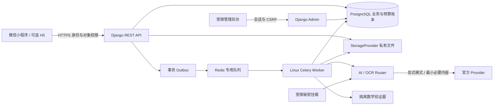
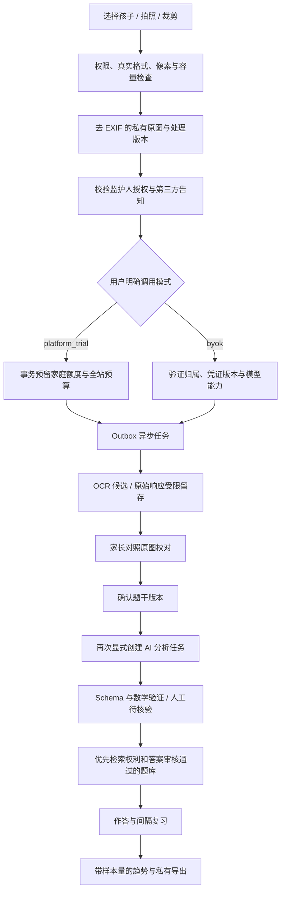
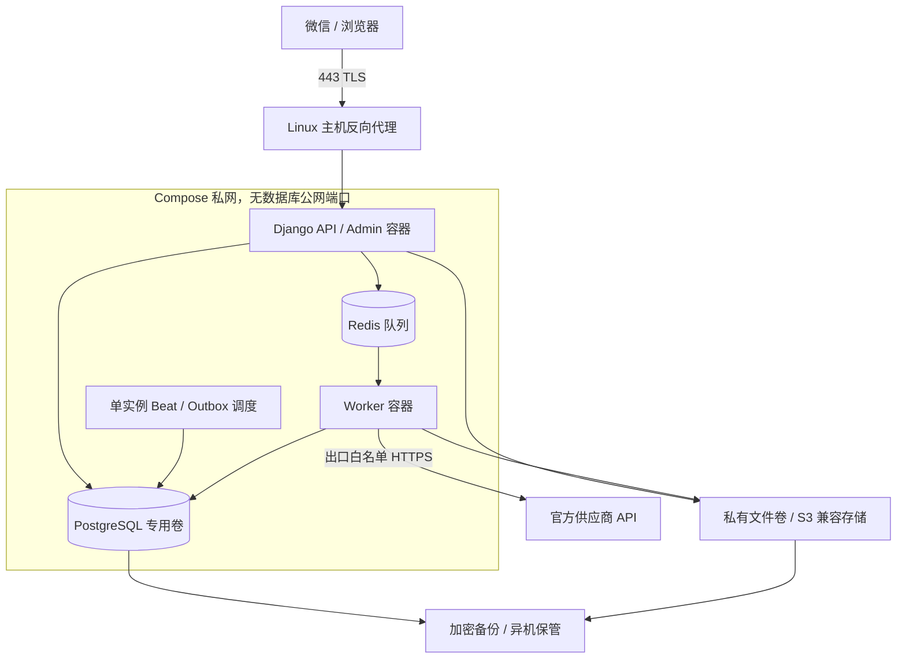
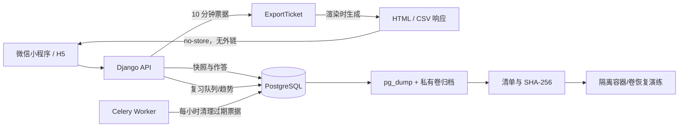

# 架构概览

Phase 4：微信小程序已配置真实 AppID 并通过本机 CLI 导入，分析页使用确认题干/作答→统一受预算保护任务→独立 Schema→提示/解析候选→人工反馈链路。任务与 OCR 共用金额窗口和点数，新增运营预警与不可变分析历史；真实微信联网、供应商和界面交互仍待验收，见 [Phase 4 报告](../acceptance/phase-4-report.md)。

2026-10-24 实现补充：私图由授权 API 读取，API/Worker 共享本地私图卷，无公开媒体路径。Phase 3 OCR 通过事务 Outbox→Redis→Worker→候选文本，任务和预算账本由 PostgreSQL 行锁及幂等性约束保护。独立模板 ocr-transcribe-v1 仅转录；未实现 Phase 4 数学分析。故障处理见 [Phase 3 运维](../operations/phase-3-operations.md)。以下设计包含后续阶段，不能视为全部已实现。

日期：2026-10-22。设计状态，不代表已实现或已部署。范围与取舍见 [ADR 索引](adr/README.md)。

Phase 2 已实现本地 API/Worker/Beat/PG/Redis、家庭/孩子/权限、密文凭证、功能权益、受限 Admin 和三页客户端。下文 Provider、Outbox、预算、私图等仍属设计。实施边界和安全缺口见 [Phase 2 报告](../acceptance/phase-2-report.md)。

## 结构与信任边界



客户端、第三方供应商、题面/模型输出均不可信。API 不采信客户端 owner/family、权益日期、额度余额、模型能力或已验证标签。管理账号不是所有私有数据的所有者；后台只拥有角色授权的管理能力。服务器 root/运行时操作者可能访问运行时密钥，无法承诺平台技术上绝对无法接触 BYOK。

## 模块与目录建议

以下为 Phase 1 起逐步建立的目录，不是当前存在的业务代码。

```text
frontend/                  uni-app Vue 3 + TypeScript，微信首发，H5 构建
backend/
  config/                  dev/test/staging/prod；URL；WSGI；Celery 启动
  apps/
    accounts/              微信身份、家庭、成员、孩子、监护人授权
    entitlements/          活动、权益、到期、提醒与审计
    problems/              私有错题、图片关联、不可变文字版本
    question_bank/         题库、来源许可、导入预览和审核
    jobs/                  任务状态、投递 Outbox、执行尝试和取消
    providers/             能力目录、凭证服务、AI/OCR 适配器
    metering/              限额、预算、预留、用量、熔断
    ai_tutor/              分析、最小运行时模板、Schema
    verification/          确定性验证器与结果
    review/                作答、练习、间隔和统计算法
    reports/               看板、PDF、导出和删除任务
    admin_ops/             有权限限制的后台与审计
  tests/                   对应模块及 PostgreSQL 集成测试
worker/                    运维入口说明；复用 backend 镜像和代码
infra/                     Compose、反向代理、环境模板和脚本
tests/                     端到端、OCR 基准格式、恢复验证
docs/                      设计、API、验收、运维与风险
```

避免复制 Worker 业务代码成第二套后端；`worker/` 只承载入口/配置，应用实现和迁移归 backend。领域间通过服务函数调用，不直接绕过 metering 或 permissions 访问 Provider。

## 关键数据流



OCR 完成不自动触发下一次付费分析。修订题干后历史分析仍可追溯，但不得作为当前版本的有效答案；重新分析由用户明确请求。原图指去除元数据后的保真像素版本，不保留含身份 EXIF 的上传字节；裁剪和旋转另记转换关系，不无提示替换原图。

## 任务与数据状态

任务：`queued → running → needs_review / succeeded / failed / cancelled`。取消请求是独立标记，运行中撤销不保证供应商停止计费；只有可确认停止才记录 cancelled。needs_review 的人工确认生成业务版本，不修改原始 OCR。

失败重试创建 JobAttempt，沿用逻辑任务和模式；每次潜在收费尝试独立预算预留。网络超时且可能已经被供应商接收时不自动重试，先标记费用未知并对账。队列按至少一次投递设计，业务不能依赖只执行一次。

题目可信状态与任务状态独立：OCR 待校对、导入未核验、AI 未核验、机器局部检查、人工核验、拒绝。权利状态、答案来源、审核发布状态独立保存。修改答案或题干会使已有版本的验证不适用于新版本。

## 部署拓扑（方案）



API 不挂载平台 Provider Key，Worker 在调用前读取平台秘密。BYOK 写入由凭证服务认证加密，Worker 调用时解密；后台和导出不获得秘密。单机多容器不是高可用，异机备份与恢复才提供灾难恢复基础。

## 界面清单与降级

微信端：登录/授权、家庭/孩子、错题列表、上传裁剪与分题、OCR 对照校对、错题详情与提示、题库推荐与练习、复习日程、趋势、AI 模式与凭证、权益、数据导出/删除。所有耗时操作有 queued/running/失败重试/额度不足状态；Key 输入提交后清除，不缓存。

后台：账号状态、活动配置、题库与知识点审核、Provider/价格/预算、任务监控、分账指标、审计。管理员凭证页面只能看掩码；私图故障排查需限时授权和审计。

pgvector 不可用时按知识点/题型/年级/难度和关键词检索。Provider 不可用时保留上传和人工录入，显示失败原因；不静默切换计费模式。数学验证不支持时进入人工复核。权益过期不阻断历史内容读取、基础导出或删除。

## Phase 6/7 练习、导出与恢复



练习链路不经过供应商：复习调度是固定阶梯，导出在请求时渲染，不产生服务器端文件。备份由 `scripts/backup.py` 生成数据库 dump、媒体归档与清单；恢复演练在一次性容器和独立卷中完成，并校验迁移数、触发器、业务行与媒体哈希。生产编排见 `infra/deploy/`，入口与回滚见 [Phase 7 运维手册](../operations/phase-7-deployment.md)。
