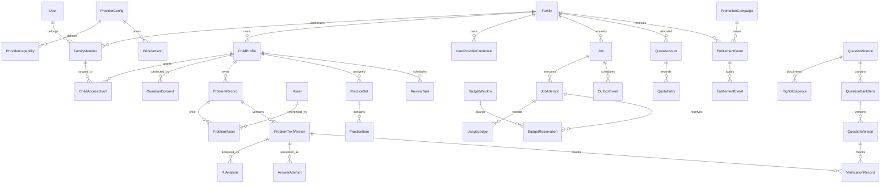

# 数据模型草案

Phase 4 补充：AnalysisInput、Analysis、AnalysisFeedback、ServicePreference 已落地，OCRJob 增加 task_type/text_version，OCRModel 增加文本/JSON 能力、分析启用和 OCR/分析点数；预算策略/窗口增加预警配置和去重状态。累计 34 项迁移。分析输入和输出按题干版本绑定，反馈追加历史，不升级已核验状态，见 [Phase 4 API](../api/phase-4-api.md)。

2026-10-24 实现补充：Phase 3 已落地 Problem、ProblemTextVersion、Asset、ProblemAsset、StoredObject，及 OCRModel/OCRJob/Outbox、BudgetPolicy/PriceVersion/BudgetWindow/QuotaWindow/UsageLedger。实际字段和接口以 [Phase 3 API](../api/phase-3-api.md) 为准。文本历史、同孩子图片引用和任务费用绑定由 PostgreSQL 触发器约束；StoredObject 清单在账号级联后继续驱动物理清理。真实供应商配置尚未建立。

日期：2026-10-22。下文为全产品概念设计，Phase 2 实施范围见下一段和实际 API；未实施实体仍是草案。UUID 不能代替授权，时间按 UTC 保存，活动另存 IANA 时区；未来金额使用 Decimal/整数最小计量单位。

Phase 2 更新：已实施 Django 基础/Admin 表和 accounts/credentials/entitlements，共 22 项迁移。包括身份/哈希会话、家庭/成员/孩子范围、授权、邀请、删除回执/审计、密文凭证、基础限额、活动/权益快照/事件与站内通知。字段与约束见 models 和 [实际 API](../api/phase-2-api.md)。错题/资产/AI/预算/题库/复习尚未创建。无生效活动种子，专用验收账号已清理。

## 核心实体关系

## 身份与私有内容

| 实体 | 主要字段与约束 |
| --- | --- |
| User / AuthIdentity | 状态、注册时间、注销时间；微信 `(appid, openid)` 唯一；不采信前端 openid |
| Family / FamilyMember | 成员角色、启停和邀请状态；`(family,user)` 唯一；移除成员撤销会话和范围授权 |
| ChildProfile / ChildAccessGrant | 家庭、昵称、可选年级学期教材；成员/孩子/操作范围；学生只绑定授权孩子 |
| GuardianConsent | 家庭/孩子、监护人、告知版本、外发 Provider/用途范围、授权和撤回时间；撤回立即阻止未开始外发 |
| ProblemRecord | family、child、创建者、当前确认版本、来源/分类、错误日期、状态、删除标记；child 必须属于同一家庭 |
| Asset / ProblemAsset | family、随机对象键、真实 MIME、像素、哈希、版本/转换、清理状态；关联题目的家庭一致；不跨家庭去重 |
| ProblemTextVersion | problem、序号、来源 OCR/人工、父版本、文本、公式结构、修改者、确认时间；`(problem,version)` 唯一且内容不可变 |
| AIAnalysis | 确认题干版本、attempt、Schema/模板/Provider/Model 版本、结构化结果、不确定性、纠错状态；不存密钥或完整 HTTP 头 |
| PracticeSet / PracticeItem | 家庭/孩子、顺序、固定题目版本、来源与匹配理由；私有/公共题库引用分别授权 |
| AnswerAttempt / ReviewTask | 孩子、明确题目版本、答案/正误/提示/可选耗时、自评、算法版本；复习状态和到期时间 |
| ExportJob / DeletionRequest | 请求者、家庭/孩子范围、私有产物、有效期、清理进度；删除和备份 tombstone 关联 |

高频列表建立 `(family_id,child_id,deleted_at,created_at,id)` 索引；复习 `(child_id,status,due_at)`，任务 `(family_id,status,created_at)`。所有外键路径检查家庭/孩子一致，使用服务层校验与可行的复合约束/触发器；不能仅依赖 serializer 外的人工约定。

## 费用、任务与凭证

| 实体 | 主要字段与约束 |
| --- | --- |
| ProviderConfig / ProviderCapability | 官方端点预置 ID、协议、模型精确 ID、输入模态、JSON 能力、上下文、启停、核对来源与日期；不含明文秘密 |
| PriceVersion | Provider/Model、币种、输入/输出/缓存/图片单价、单位、有效区间、最大计费上界依据、来源；版本不可变 |
| UserProviderCredential | family、owner_user、Provider、ciphertext、nonce、key_version、credential_version、掩码后缀、启停、验证/轮换/删除；普通 API 永不读密文 |
| Job | family、child、发起人、类型、billing_mode、credential/version 或平台 secret_ref、Provider/Model/能力版本、题目版本、告知版本、幂等键、请求摘要、状态、取消标记 |
| JobAttempt | job、尝试序号、执行租约、fencing token、发送时间、供应商 request_id、结果、用量是否已知、费用是否已确定 |
| OutboxEvent | 与 Job/预留同事务写入的可重复投递事件、投递状态、租约；仅含对象 ID，不含题目/密钥 |
| BudgetPolicy / BudgetWindow | 配置版本、币种、周期时区、daily/monthly/lifetime 硬额、已结算/预留值、熔断状态和原因；缺任一强制配置则拒绝 |
| BudgetReservation | attempt、window、预留上界、状态、结算金额、价格版本；`(attempt,window)` 唯一；不允许超时盲目释放 |
| QuotaPolicy / QuotaAccount | 家庭、适用活动/用户、任务系数、周期、已用/预留；`(family,policy,period)` 唯一 |
| QuotaEntry / UsageLedger | append-only 预留/扣减/返还/调整事件，唯一事件键、模式、Provider、Model、用量、估算/未知、价格版本；分账不混算 |
| AuditLog | 操作者、作用域、动作、理由、对象 ID、变化摘要、request_id、结果；不保存题目全文/Key/Authorization |

`Job` 的约束：byok 必须有当前有效凭证归属/version，platform_trial 不得有用户凭证引用；任务创建后调用模式不可修改。同一逻辑请求不因重试改变模式，用户切换须创建新请求。凭证停用/删除/替换使未发送旧版本任务失败，不能自动换成新 Key。

幂等唯一键建议 `(family_id,actor_id,operation,idempotency_key)`；相同键不同请求摘要返回冲突。额度预留按逻辑任务只一次，费用预算按每次潜在收费尝试分开预留。新尝试前必须完成额外预算判断。

## 权益与题库

| 实体 | 主要字段与约束 |
| --- | --- |
| PromotionCampaign | 名称、状态、资格窗口、eligibility_timezone、duration_months（默认配置值 6）、适用范围、allow_existing、功能快照模板、名额、提醒偏移、审计版本 |
| EntitlementGrant | family、campaign、源用户、功能快照、starts_at、expires_at、撤销时间/理由、发放人；`(campaign,family)` 唯一，重复请求不延长 |
| EntitlementEvent | grant、事件类型/计划时间/渠道、结果、人工原因；提醒 `(grant,node,channel)` 唯一；到期事件唯一 |
| QuestionSource / RightsEvidence | 来源主体、许可证据、地域/用途/期限/署名、审核者与状态；题干/答案/解析的权利分别记录 |
| QuestionBankItem / QuestionVersion | 可见范围、题目版本、答案/解析版本、知识点/题型/难度、去重指纹、审核状态、生成原题关联/意图、Provider/Model |
| VerificationRecord | 输入版本/哈希、验证器/方法/版本、passed/failed/not_supported/needs_human_review、具体覆盖范围、人工审核者、时间、来源 |

公开检索同时要求发布审核通过、当前权利有效且覆盖所需用途、答案来源合格。生成题升级可信公共题库需要权利审核与人工确认；machine_checked 仅证明特定验证范围。原图不由模型重绘覆盖。

## 保留、迁移与恢复

删除先冻结范围与新任务，撤销下载/访问，再异步清理对象和派生数据；多题共用 Asset 时检查所有同家庭引用。审计保留最少事件信息，具体期限由上线前数据政策确认。撤销与备份删除清单独立持久化，恢复必须重新应用，防止已删数据复活。

备份包含 DB、对象实际内容、清单/哈希、活动快照、预算账本和加密版本元数据。主密钥独立保管。恢复后先禁止外部调用、重建账本、人工处置发送状态不明任务；严禁直接重放旧付费任务。

## Phase 6 练习与复习实体

| 实体 | 主要字段与约束 |
| --- | --- |
| Worksheet | child、标题、创建者、revision、deleted_at；`(child, deleted_at, created_at)` 索引；单孩子 200 份 |
| WorksheetItem | worksheet、position、origin(problem/bank/variant)、problem 或 bank_item_id+bank_revision、文本/答案/解析快照、知识点、math_spec；`(worksheet, position)` 唯一，来源绑定不可 UPDATE |
| Attempt | item、number、answer、self_grade、is_correct（unsure 为 NULL）、graded_by(auto/self)、duration；`(item, number)` 唯一，禁止 UPDATE |
| ReviewSchedule | child、problem、due_on、level(0–6)、interval_days、streak、lapses、stage；`(child, problem)` 唯一，`(child, due_on)` 索引 |
| ReviewEvent | child、problem、grade、level_before/after、interval_after、due_on、actor；append-only |
| ExportTicket | kind(worksheet/summary)、child、worksheet、nonce、expires_at、revoked_at；身份字段不可改，撤销只能写一次 |

级联规则：删除错题 → 题单项、作答、复习计划与事件级联删除；删除题单 → 题单项与作答级联、票据撤销；账号注销 → 以上全部随孩子档案级联。题库题目为共享数据，不随用户删除，但读取时按当前许可与修订重新判定可用性。
